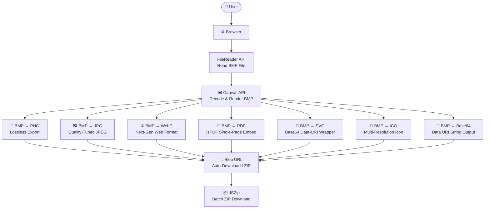

<div align="center">

# ⚡ PixelForge BMP Suite

### Enterprise-Grade, Client-Side BMP Image Conversion Toolkit

[](LICENSE)
[](CONTRIBUTING.md)
[](https://serviceprovidermanchester.github.io/SPManchester-BMP-Suite/)
[](https://serviceprovidermanchester.github.io/SPManchester-BMP-Suite/)
[](https://developer.mozilla.org/en-US/docs/Web/HTML)
[](https://developer.mozilla.org/en-US/docs/Web/CSS)
[](https://developer.mozilla.org/en-US/docs/Web/JavaScript)
[](https://serviceprovidermanchester.github.io/SPManchester-BMP-Suite/)

<br/>

> **Built with ❤️ by [SPManchester Private Limited](https://www.spmanchester.com)**

<br/>

[🚀 Live Demo](https://serviceprovidermanchester.github.io/SPManchester-BMP-Suite/) · [🐛 Report Bug](https://github.com/serviceprovidermanchester/SPManchester-BMP-Suite/issues/new?template=bug_report.md) · [✨ Request Feature](https://github.com/serviceprovidermanchester/SPManchester-BMP-Suite/issues/new?template=feature_request.md) · [🤝 Contributing](CONTRIBUTING.md)

</div>

---

## 📖 Overview

**PixelForge BMP Suite** is a production-ready, zero-dependency, 100% client-side BMP image conversion toolkit. It eliminates the privacy risks and latency of server-based converters by processing every image entirely within the user's browser using the native **Canvas API**, **FileReader API**, and **Blob API** — no uploads, no accounts, no data leaving the device.

Where most online converters are single-format, ad-riddled, and server-dependent, PixelForge delivers **seven professional-grade conversion pipelines** in one cohesive suite — packaged as a pure static site deployable anywhere from GitHub Pages to an enterprise intranet. It handles individual files and entire batches with equal ease, offering aspect-ratio-safe resizing and one-click ZIP download out of the box.

> **Who is it for?** Developers needing a self-hostable conversion tool, designers converting legacy BMP assets, enterprise teams requiring data-privacy compliance, and power users who refuse to upload sensitive images to third-party servers.

---

## 🌐 Live Demo

> 🔗 **[https://serviceprovidermanchester.github.io/SPManchester-BMP-Suite/](https://serviceprovidermanchester.github.io/SPManchester-BMP-Suite/)**

---

## 🏗️ Architecture



> All processing occurs **entirely in the browser**. Zero bytes are transmitted to any server.

---

## 🛠️ Feature Matrix

| Tool | Output Format | Description | Key Features |
|------|--------------|-------------|--------------|
| **BMP → PNG** | `.png` | Lossless raster conversion | Transparency support, full-fidelity pixel data, batch queue |
| **BMP → JPG** | `.jpg` | Compressed JPEG output | Adjustable quality slider (1–100), aspect-safe resize presets |
| **BMP → WebP** | `.webp` | Next-gen web image format | Superior compression, broad browser support, batch ZIP export |
| **BMP → PDF** | `.pdf` | Single-page PDF document | Pixel-perfect embed via jsPDF, A4/custom page size, batch support |
| **BMP → SVG** | `.svg` | Scalable Vector Graphic wrapper | Base64 data-URI embed, lossless scaling, XML-compliant output |
| **BMP → ICO** | `.ico` | Windows icon format | Multi-size canvas rendering, batch processing, instant download |
| **BMP → Base64** | Base64 string | Inline data URI for HTML/CSS/JS | Copy-to-clipboard, one-click export, batch text file output |

---

## 🚀 Tech Stack

| Layer | Technology | APIs / Features Used |
|-------|-----------|----------------------|
| **Markup** | HTML5 | `<canvas>`, `<input type="file" multiple>`, semantic elements, drag-and-drop |
| **Styling** | CSS3 | Custom properties (CSS variables), CSS Grid, Flexbox, responsive breakpoints, `@media` queries |
| **Logic** | Vanilla JavaScript (ES6+) | `FileReader`, `Canvas 2D Context`, `Blob`, `URL.createObjectURL`, `Promise`, `async/await` |
| **Compression** | JSZip *(bundled, no CDN)* | In-browser ZIP archive creation for batch downloads |
| **Hosting** | GitHub Pages | Static site deployment, zero infrastructure cost |

> **Zero build tools.** No Webpack, no Vite, no npm. Open `index.html` and it works.

---

## 📦 Installation

### Option 1 — Use the Live Demo

Visit the [Live Demo](https://serviceprovidermanchester.github.io/SPManchester-BMP-Suite/) directly. No installation required.

### Option 2 — Run Locally

```bash
# 1. Clone the repository
git clone https://github.com/serviceprovidermanchester/SPManchester-BMP-Suite.git

# 2. Navigate into the project
cd SPManchester-BMP-Suite

# 3. Open the suite hub in your browser
# Simply double-click index.html, or:
start index.html          # Windows
open index.html           # macOS
xdg-open index.html       # Linux
```

That's it. **No `npm install`. No build step. No server required.**

---

## 📁 Project Structure

```
SPManchester-BMP-Suite/
│
├── index.html                  # 🏠 Suite Hub — links to all 7 tools
│
├── bmp-to-png/
│   ├── index.html              # BMP → PNG converter
│   ├── style.css
│   └── app.js
│
├── bmp-to-jpg/
│   ├── index.html              # BMP → JPG converter
│   ├── style.css
│   └── app.js
│
├── bmp-to-webp/
│   ├── index.html              # BMP → WebP converter
│   ├── style.css
│   └── app.js
│
├── bmp-to-pdf/
│   ├── index.html              # BMP → PDF converter
│   ├── style.css
│   └── app.js
│
├── bmp-to-svg/
│   ├── index.html              # BMP → SVG converter
│   ├── style.css
│   └── app.js
│
├── bmp-to-ico/
│   ├── index.html              # BMP → ICO converter
│   ├── style.css
│   └── app.js
│
├── bmp-to-base64/
│   ├── index.html              # BMP → Base64 converter
│   ├── style.css
│   └── app.js
│
├── LICENSE                     # MIT License
├── README.md                   # This file
├── CONTRIBUTING.md             # Contribution guidelines
├── SECURITY.md                 # Security policy
├── CODE_OF_CONDUCT.md          # Contributor Covenant v2.1
├── CHANGELOG.md                # Semantic versioning changelog
└── .github/
    ├── workflows/
    │   └── pages.yml           # GitHub Actions → GitHub Pages deployment
    ├── ISSUE_TEMPLATE/
    │   ├── bug_report.md
    │   ├── feature_request.md
    │   └── config.yml
    └── PULL_REQUEST_TEMPLATE.md
```

---

## 🔧 Usage

### Using the Web Tool

1. **Open the Suite Hub** — Navigate to [Live Demo](https://serviceprovidermanchester.github.io/SPManchester-BMP-Suite/) or open `index.html` locally.
2. **Select a Converter** — Click any of the 7 conversion tools.
3. **Upload BMP Files** — Drag & drop or click *"Choose Files"* to select one or more `.bmp` images.
4. **Configure Options** — Set quality (JPG), resize preset (original / 75% / 50% / 25% / custom), or format-specific settings.
5. **Convert** — Click the *Convert* button. Processing is instant and runs entirely in-browser.
6. **Download** — Download individual files or click *"Download All as ZIP"* for batch results.

### Self-Hosting

Host this project on **any static file server** — no backend required:

```bash
# Example: Python's built-in HTTP server (for local LAN hosting)
python -m http.server 8080

# Example: Node.js http-server
npx http-server . -p 8080

# Example: Nginx — just point document root to the project folder
```

### Deploying to GitHub Pages

**Method A — GitHub Actions (Recommended)**

The workflow at [`.github/workflows/pages.yml`](.github/workflows/pages.yml) deploys automatically on every push to `main`.

1. Fork or push this repo to GitHub.
2. Go to **Settings → Pages → Source** → Select **GitHub Actions**.
3. Push a commit to `main`. The workflow deploys within ~60 seconds.
4. Your site will be live at `https://YOUR-USERNAME.github.io/SPManchester-BMP-Suite/`.

**Method B — Classic `gh-pages` Branch**

1. Go to **Settings → Pages → Source** → Select **Deploy from a branch**.
2. Choose `main` branch, `/ (root)` folder.
3. Click **Save**. GitHub Pages serves the static files automatically.

---

## 🗺️ Roadmap

The following enhancements are planned for future releases. Community contributions are welcome.

| Priority | Feature | Description |
|----------|---------|-------------|
| 🔴 High | **PNG Optimization** | Integrate `pngquant`-style lossy PNG compression in-browser via WASM |
| 🔴 High | **PWA / Offline Support** | Service Worker + `manifest.json` for full offline capability |
| 🟡 Medium | **WebP Animation** | Multi-frame BMP sequence → Animated WebP pipeline |
| 🟡 Medium | **CLI Mode** | Node.js-compatible CLI wrapper using `node-canvas` for server-side automation |
| 🟢 Low | **NPM Package** | Publish core conversion functions as a typed, tree-shakeable NPM module |
| 🟢 Low | **Dark Mode** | System-preference-aware `prefers-color-scheme` theming |
| 🟢 Low | **i18n / Localization** | Internationalization support for non-English speaking users |

> Track progress and vote on features in [GitHub Issues](https://github.com/serviceprovidermanchester/SPManchester-BMP-Suite/issues).

---

## 🤝 Contributing

We welcome contributions of all kinds — bug fixes, feature additions, documentation improvements, and design enhancements.

**Before you start**, please read our **[Contributing Guide](CONTRIBUTING.md)** and **[Code of Conduct](CODE_OF_CONDUCT.md)**.

**Quick contribution flow:**

```bash
# 1. Fork the repository on GitHub

# 2. Clone your fork
git clone https://github.com/YOUR-USERNAME/SPManchester-BMP-Suite.git

# 3. Create a feature branch (see branch naming conventions in CONTRIBUTING.md)
git checkout -b feature/your-feature-name

# 4. Make changes — open index.html in browser to test, no build step needed

# 5. Commit using Conventional Commits format
git commit -m "feat: add WebP animation support"

# 6. Push and open a Pull Request against main
git push origin feature/your-feature-name
```

> See [`CONTRIBUTING.md`](CONTRIBUTING.md) for the full PR checklist, code style guide, and commit message conventions.

---

## 🔒 Security

PixelForge BMP Suite processes all data **100% client-side**. There is no server, no database, no authentication layer, and no network transmission of user files. The attack surface is intentionally minimal.

If you discover a security vulnerability, please follow our responsible disclosure process outlined in [`SECURITY.md`](SECURITY.md).

📧 **Security contact:** [security@spmanchester.com](mailto:security@spmanchester.com)

---

## 📋 Changelog

See [`CHANGELOG.md`](CHANGELOG.md) for the complete version history following [Keep a Changelog](https://keepachangelog.com/) conventions and [Semantic Versioning](https://semver.org/).

**Latest:** `v1.0.0` — Initial public release (2026-11-19)

---

## 🏢 About SPManchester Private Limited

<div align="center">

**[SPManchester Private Limited](https://www.spmanchester.com)**

</div>

SPManchester Private Limited is a software development company specialising in building high-performance web tools, enterprise-grade open-source utilities, and digital solutions for clients across industries. We are committed to building privacy-first, dependency-free software that is accessible to everyone.

| | |
|---|---|
| 🌐 **Website** | [www.spmanchester.com](https://www.spmanchester.com) |
| 📧 **Email** | [info@spmanchester.com](mailto:info@spmanchester.com) |
| 🛡️ **Security** | [security@spmanchester.com](mailto:security@spmanchester.com) |
| 📄 **License** | [MIT](LICENSE) — free to use, modify, and distribute |

---

## ⭐ Star History

If PixelForge BMP Suite saves you time or solves a problem, please consider giving it a ⭐ — it helps the project reach more developers who need it.

[](https://star-history.com/#serviceprovidermanchester/SPManchester-BMP-Suite&Date)

---

## 👤 Author

**Sayed Mudassar Akbar**
*on behalf of SPManchester Private Limited*

- 🌐 [www.spmanchester.com](https://www.spmanchester.com)
- 📧 [info@spmanchester.com](mailto:info@spmanchester.com)
- 💼 [GitHub](https://github.com/serviceprovidermanchester)

---

## 🙏 Acknowledgments

- [MDN Web Docs](https://developer.mozilla.org/) — Comprehensive reference for Canvas, FileReader, and Blob APIs
- [jsPDF](https://github.com/parallax/jsPDF) — Client-side PDF generation library
- [JSZip](https://stuk.github.io/jszip/) — In-browser ZIP file creation
- [Shields.io](https://shields.io/) — Badge generation
- [Contributor Covenant](https://www.contributor-covenant.org/) — Code of Conduct standard
- The open-source community for inspiration and best practices

---

<div align="center">

**[⬆ Back to Top](#-pixelforge-bmp-suite)**

---

*Copyright © 2026 SPManchester Private Limited. All Rights Reserved.*

*PixelForge BMP Suite is released under the [MIT License](LICENSE).*
*You are free to use, copy, modify, merge, publish, distribute, sublicense, and/or sell copies of this software.*

</div>
